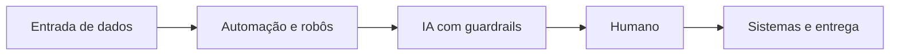

# Portfólio: Automação e IA aplicada

Projetos práticos de automação, integração de sistemas e IA com supervisão humana.

## O que este repositório prova

- Automatização de processos e coleta de dados com resultados verificáveis.
- Aplicação de IA em atendimento, triagem e análise, com decisões humanas quando necessário.
- Engenharia com testes automatizados, integração de sistemas e CI.

## Projetos

| Projeto | Em uma frase | Ver |
| --- | --- | --- |
| Conciliação de legado | Compara contribuições da folha com um sistema sem API e destaca divergências para revisão. | [rpa-legacy-reconciliation](rpa-legacy-reconciliation/) |
| Monitor judicial | Acompanha publicações do DJEN (CNJ) e movimentações do PJe (TJDFT) por número de processo, com estado idempotente, alerta de falha e auditoria, sem busca por pessoa. | [judicial-monitor](judicial-monitor/) |
| Assistente para loja de autopeças | Faz triagem de mensagens e pausa o bot quando um humano assume. | [whatsapp-ai-agent](whatsapp-ai-agent/) |
| Qualificação de leads | Extrai dados iniciais de mensagens e prepara resumo para revisão por advogado. | [lead-qualifier-agent](lead-qualifier-agent/) |
| Cascata de classificação | Cascata de classificação: Spark ML resolve o que tem confiança e só o resto vai para a LLM, com acurácia e custo medidos no projeto original. | [spark-ai-cascade](spark-ai-cascade/) |
| Roteador de LLM | Tenta outro provedor quando uma resposta falha temporariamente. | [llm-router](llm-router/) |
| Coletores RPA | Coleta dados públicos e identifica alterações sem duplicar registros. | [rpa-collectors](rpa-collectors/) |
| Radar de IA | Reúne e resume notícias inéditas de fontes públicas. | [ai-radar](ai-radar/) |
| Zonas de manejo | Identifica diferenças de vegetação e sugere pontos para amostragem de solo. | [soil-management-zones](soil-management-zones/) |

## Governança de IA por projeto

| Projeto | Classe de risco (baixo/médio/alto, avaliação própria) | Decisão humana em | O que sai para LLM externo | Registro/auditoria |
| --- | --- | --- | --- | --- |
| [rpa-legacy-reconciliation](rpa-legacy-reconciliation/) | Médio | Revisão de divergências e correções; robô apenas lê | Nenhum LLM | Eventos JSONL, relatório e captura em falha |
| [judicial-monitor](judicial-monitor/) | Médio | Acompanhamento dos processos e providências | Nenhum LLM | Auditoria e estado idempotente |
| [whatsapp-ai-agent](whatsapp-ai-agent/) | Médio | Atendimento assumido por pessoa | Mensagem do cliente com dados pessoais mascarados | Decisões em JSONL; estado em SQLite |
| [lead-qualifier-agent](lead-qualifier-agent/) | Alto | Decisão jurídica com advogado | Uma mensagem do lead por chamada e campos ausentes; histórico reprocessado individualmente | Resumo retornado ao integrador; API não persiste dados |
| [spark-ai-cascade](spark-ai-cascade/) | Médio | Uso dos resultados da classificação | Na réplica, dados sintéticos de casos de baixa confiança | Métricas de acurácia e custo no projeto original |
| [llm-router](llm-router/) | Médio | Uso da resposta e configuração de provedores | Prompt informado pelo usuário | Provedor e latência na resposta; sem auditoria persistente |
| [rpa-collectors](rpa-collectors/) | Baixo | Uso dos dados coletados | Nenhum LLM | Registros e hashes em SQLite; contagens por execução |
| [ai-radar](ai-radar/) | Baixo | Leitura e uso do digest | Título e descrição de notícia pública | Digest, estado de links e alerta de falha |
| [soil-management-zones](soil-management-zones/) | Médio | Escolha e análise das amostras de solo | Nenhum LLM | Mapas, pontos e resumo das cenas utilizadas |

Classificação inspirada em políticas públicas de uso de IA (risco, supervisão humana, inventário); é uma autoavaliação, não uma certificação.

## Requisitos

| Requisito | Onde ver |
| --- | --- |
| Automação e RPA | [rpa-legacy-reconciliation](rpa-legacy-reconciliation/), [rpa-collectors](rpa-collectors/), [judicial-monitor](judicial-monitor/) |
| APIs e integração | [judicial-monitor](judicial-monitor/), [whatsapp-ai-agent](whatsapp-ai-agent/), [lead-qualifier-agent](lead-qualifier-agent/) |
| IA prática | Extração estruturada em [lead-qualifier-agent](lead-qualifier-agent/), [spark-ai-cascade](spark-ai-cascade/), [llm-router](llm-router/), [whatsapp-ai-agent](whatsapp-ai-agent/) |
| Arquitetura e banco de dados | [spark-ai-cascade](spark-ai-cascade/), [rpa-collectors](rpa-collectors/), [whatsapp-ai-agent](whatsapp-ai-agent/) |
| Boas práticas e evitar over-engineering | [spark-ai-cascade](spark-ai-cascade/): LLM só onde compensa; [llm-router](llm-router/) |
| Monitorar e evoluir | Auditoria JSONL em [whatsapp-ai-agent](whatsapp-ai-agent/), [rpa-legacy-reconciliation](rpa-legacy-reconciliation/) e [judicial-monitor](judicial-monitor/); alertas de falha em [ai-radar](ai-radar/) e [judicial-monitor](judicial-monitor/) |

## Princípios

- Humano no loop onde há decisão, com encaminhamento para revisão.
- Fallback e resiliência diante de falhas de provedores e entregas.
- Idempotência nas coletas, com identificação de registros e alterações.
- Dados fictícios ou públicos, sem dado pessoal real.

## Como rodar

Em cada projeto, execute `uv sync` e `uv run pytest -q`. Consulte seu README para executar as funcionalidades e configurar integrações.

## Como regenerar as imagens

Na raiz, execute `uv run --with rich --with playwright python scripts/make_screenshots.py`; se necessário, instale o navegador com `uv run --with playwright playwright install chromium`. A página Swagger usa recursos carregados pela internet. Para a tela do legado, execute `uv run python scripts/make_screenshot.py` dentro de `rpa-legacy-reconciliation/`, com a localidade `pt_BR.UTF-8` instalada no sistema.

## Sobre

Réplicas simplificadas e reescritas de projetos reais em produção. Nenhum código, dado ou nome de cliente foi reutilizado.
