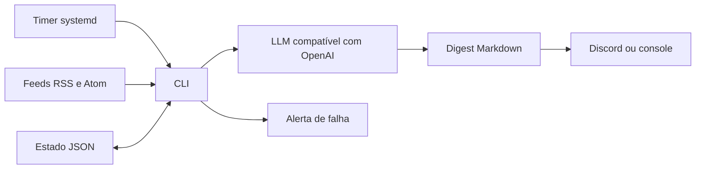

# Radar de IA

## Problema
Acompanhar fontes de inteligência artificial manualmente consome tempo e repete notícias já vistas.

## Solução
O radar consulta feeds públicos, resume itens inéditos por categoria e gera um arquivo Markdown. Ele envia o digest ao Discord ou imprime quando o webhook não está configurado.

## Demonstração


O digest agrupa por categoria os itens da fixture resumidos pelo provedor fictício.

## Arquitetura


## Stack
Python 3.12, HTTPX, feedparser, Pydantic v2, PyYAML, pytest e uv.

## Como rodar
```bash
uv sync
cp .env.example .env
# Exporte LLM_API_KEY e as demais variáveis desejadas no ambiente.
uv run ai-radar run --dry-run
uv run ai-radar run
```
Execute na pasta do projeto. Configure `LLM_BASE_URL` e `LLM_MODEL` se necessário; o padrão usa a API OpenAI. Configure `DISCORD_WEBHOOK_URL` para enviar ao Discord. O modo de teste ainda consulta feeds e LLM, grava o digest e imprime, mas não envia nem altera o estado. Os arquivos em `deploy/` são exemplos: ajuste caminhos, usuário e ambiente antes de instalar o timer.

## Testes
```bash
uv run pytest -q
```
Os testes usam XML local, LLM fictício e transporte HTTP simulado, sem rede.

## Decisões de projeto
- URLs são identificadas por SHA-256 e mantidas no estado por 30 dias.
- O estado só é gravado após a entrega; uma falha gera alerta e pode causar reenvio na próxima execução.
- O serviço envia alertas e o exemplo systemd também usa `OnFailure`; falhas podem gerar dois alertas.
