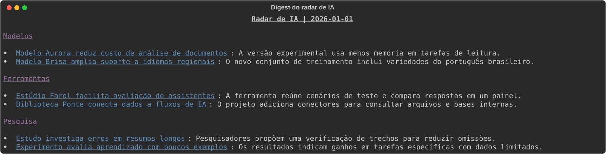
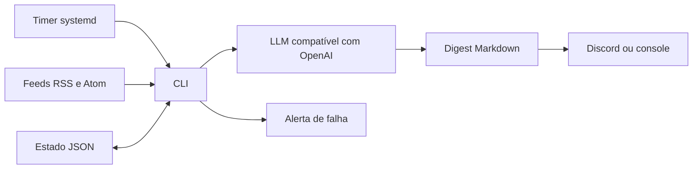

# Radar de IA
> Reduz o trabalho de acompanhar notícias de IA com resumos de itens ainda não vistos.

**O que este projeto prova**
- Reúne notícias de fontes públicas por categoria.
- Evita repetir links já registrados no período de retenção.
- Entrega um digest em Markdown ao Discord ou ao console.

## Demonstração


O digest agrupa por categoria os itens da fixture resumidos pelo provedor fictício.

## Como funciona

- A execução consulta feeds e identifica links ainda não vistos.
- Um modelo resume os itens, agrupados em um digest por categoria.
- O digest é salvo e enviado ao Discord ou impresso; falhas geram alerta.

## Decisões de projeto
- URLs são identificadas por SHA-256 e mantidas no estado por 30 dias.
- O estado só é gravado após a entrega; uma falha gera alerta e pode causar reenvio na próxima execução.
- O serviço envia alertas e o exemplo systemd também usa `OnFailure`; falhas podem gerar dois alertas.

<details>
<summary>Detalhes técnicos: stack, como rodar e testes</summary>

Stack: Python 3.12, HTTPX, feedparser, Pydantic v2, PyYAML, pytest e uv.

```bash
uv sync
cp .env.example .env
# Exporte LLM_API_KEY e as demais variáveis desejadas no ambiente.
uv run ai-radar run --dry-run
uv run ai-radar run
```
Execute na pasta do projeto. Configure `LLM_BASE_URL` e `LLM_MODEL` se necessário; o padrão usa a API OpenAI. Configure `DISCORD_WEBHOOK_URL` para enviar ao Discord. O modo de teste ainda consulta feeds e LLM, grava o digest e imprime, mas não envia nem altera o estado. Os arquivos em `deploy/` são exemplos: ajuste caminhos, usuário e ambiente antes de instalar o timer.

Testes:
```bash
uv run pytest -q
```
Os testes usam XML local, LLM fictício e transporte HTTP simulado, sem rede.

Variáveis em `.env.example`: `LLM_API_KEY`, `LLM_BASE_URL`, `LLM_MODEL` e `DISCORD_WEBHOOK_URL`.
</details>
