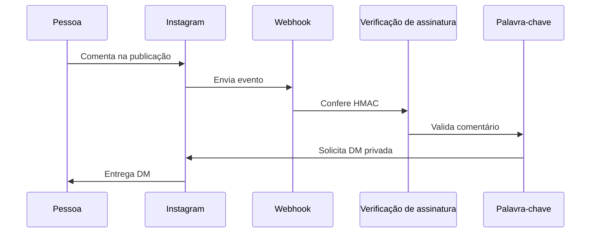

# Resposta automática no Instagram
> Responde comentários com palavra-chave por mensagem privada, sem atendimento manual.

**O que este projeto prova**
- TypeScript e integração com webhook protegido por assinatura.
- Idempotência no envio e resposta pública opcional.
- Privacidade por desenho e retenção de 90 dias.

Implementação real pronta; ativação em produção aguardando verificação da empresa na Meta.

## Demonstração

```text
{"event":"private_reply_sent","comment_id":"comment-fictional"}
{"event":"cleanup","deleted":1}
```

## Como funciona



- O webhook verifica a assinatura antes de interpretar o evento.
- Uma palavra inteira, sem distinção de acentos ou maiúsculas, inicia a resposta.
- O ID do comentário é reservado antes do envio; duplicatas não geram outra DM.
- Uma rotina diária remove registros com mais de 90 dias e renova o token.

## Decisões de projeto

- D1 guarda apenas ID do comentário, IGSID e data, sem texto ou nome de usuário.
- Falhas são registradas e respondidas com HTTP 200; não há nova tentativa, inclusive após falha de rede, para evitar duplicação. A reserva também permanece se o envio falhar.
- A renovação mantém o token atualizado no KV; o token inicial é um secret e não aparece nos logs.

<details>
<summary>Detalhes técnicos: stack, como rodar e testes</summary>

Node 20+, pnpm, TypeScript, Vitest, Cloudflare Workers, D1 e KV.

1. Execute `pnpm install --frozen-lockfile`, `pnpm typecheck` e `pnpm test`.
2. Crie um banco D1 e um namespace KV, preencha seus IDs em `wrangler.jsonc` e aplique `schema.sql` ao D1.
3. Configure `APP_SECRET`, `VERIFY_TOKEN` e `IG_TOKEN` como secrets. Configure `KEYWORDS` (separadas por vírgula), `DM_TEXT` e `PUBLIC_REPLY` (vazia desativa) no ambiente do Worker. `.dev.vars.example` mostra os nomes com valores fictícios.
4. Cadastre `/webhook` na Meta e habilite os eventos de comentários e permissões necessárias. A conta precisa cumprir os requisitos da plataforma.

O cron renova o token de longa duração e salva o resultado no KV. Proteja o acesso ao namespace; ao trocar manualmente o token inicial, remova também a chave `instagram_token` do KV para usar o novo secret. Os testes são offline.
</details>
