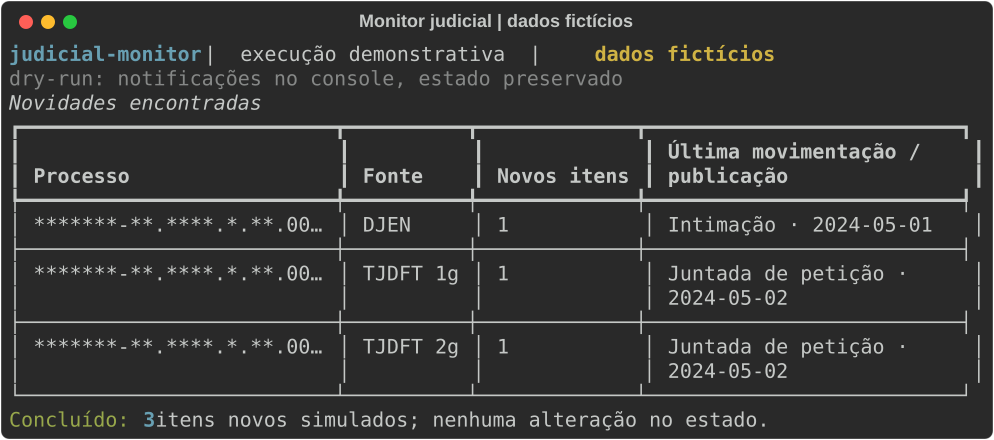

# Monitor judicial diário
> Acompanha publicações e movimentações para ajudar no controle de prazos sem abrir portais todos os dias.

**O que este projeto prova**
- Integração com APIs públicas do Judiciário, sem login.
- Robustez com novas tentativas e alerta de falha.
- Auditoria e privacidade por desenho.

## Demonstração

Execução simulada com respostas fictícias das APIs.

## Como funciona

- Consulta comunicações e movimentos dos dois graus para cada número.
- A primeira execução informa todos os itens encontrados; as seguintes informam apenas novidades.
- Falhas geram alerta e retorno de erro para o serviço.
- A auditoria registra contagens, duração e tipo de erro por fonte.

## Decisões de projeto
- Não há busca por CPF ou nome: somente números de processo, como decisão de privacidade alinhada à LGPD.
- O estado idempotente guarda identificadores após cada notificação bem-sucedida, permitindo retomada após falhas.
- O alerta no console ou webhook e a unidade OnFailure tornam falhas visíveis; o hash do processo reduz exposição no log.

<details>
<summary>Detalhes técnicos: stack, como rodar e testes</summary>

Python, uv, httpx, Pydantic, PyYAML e Rich. As URLs dos dois graus podem ser ajustadas no YAML. O número de exemplo é fictício; substitua-o antes de consultar APIs reais.

```bash
uv sync
uv run judicial-monitor run --config config.example.yaml --dry-run
uv run pytest -q
```

O dry-run consulta as APIs e escreve auditoria, mas imprime notificações e não altera o estado. Sem dry-run, `DISCORD_WEBHOOK_URL` define o webhook; sem ela, usa-se o console. Veja `.env.example` e exporte a variável no shell ou configure o arquivo `.env` para o serviço. Estado e auditoria são relativos ao arquivo de configuração. Os arquivos em `deploy/` são exemplos de unidades de usuário systemd; ajuste os caminhos e ative o timer. Horário usa o fuso do sistema. As APIs externas podem mudar ou ficar indisponíveis.
</details>
