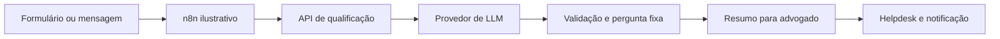

# Qualificação de leads
> Coleta informações iniciais para um escritório fictício e entrega um resumo para revisão jurídica.

**O que este projeto prova**
- Extrai informações de mensagens livres e completa a coleta com perguntas fixas.
- Filtra padrões de resposta inadequados e oferece encaminhamento seguro.
- Entrega dados estruturados para avaliação por advogado.

## Demonstração


A triagem extrai vários dados de uma mensagem e sinaliza uma dúvida jurídica.


O resumo reúne os dados coletados para revisão humana.

## Como funciona

- A API reconstrói a conversa a partir do histórico fornecido pelo integrador.
- O modelo extrai campos em JSON; a pergunta exibida é fixa e dúvidas jurídicas recebem encaminhamento seguro.
- Ao completar os campos, a API retorna um resumo; o fluxo n8n é ilustrativo.

## Decisões de projeto
- Campos obrigatórios e resumo são validados com Pydantic; o valor da dívida deve ser numérico e não negativo.
- O filtro de expressões é uma defesa parcial, não uma garantia semântica. Perguntas fixas impedem a exposição de texto arbitrário do modelo; as decisões jurídicas permanecem com o advogado.
- O histórico é fornecido pelo integrador; a API não persiste dados pessoais. Para cada extração, envia ao modelo apenas uma mensagem do lead e os nomes dos campos ainda ausentes, sem o restante do histórico.

<details>
<summary>Detalhes técnicos: stack, como rodar e testes</summary>

Stack: Python 3.12, FastAPI, Pydantic v2, HTTPX, pytest e uv.

```bash
uv sync
cp .env.example .env
# Exporte as variáveis preenchidas no ambiente antes de iniciar.
uv run uvicorn qualifier.api:app --reload
```
Envie `POST /qualify` com `{"history": [], "message": "Ana"}`. Em cada turno seguinte, preserve no histórico a mensagem do usuário e a resposta do assistente, incluindo `field` igual ao `next_field` recebido. O resumo final é retornado em `handoff`; `needs_handoff` sinaliza dúvidas jurídicas ou saída inadequada do modelo. O exemplo n8n exige adaptação dos endereços, autenticação e persistência do histórico antes do uso.

Testes:
```bash
uv run pytest -q
```
Os testes usam provedor fictício e não acessam a rede.

Variáveis em `.env.example`: `LLM_API_KEY`, `LLM_BASE_URL` e `LLM_MODEL`.
</details>
