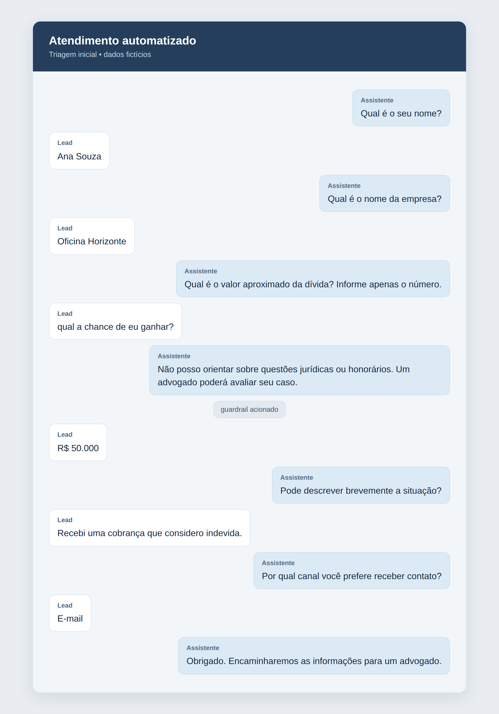
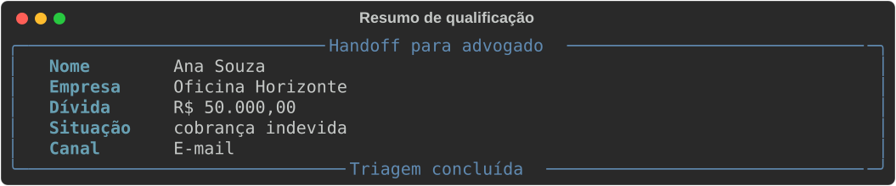
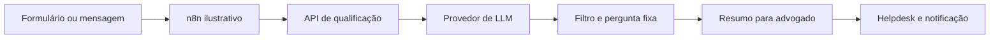

# Qualificação de leads

## Problema
Um escritório fictício precisa coletar informações iniciais sem confundir triagem com orientação jurídica.

## Solução
Uma API coleta cinco campos em sequência e entrega um resumo estruturado ao advogado. O modelo participa da resposta, submetida a um filtro de padrões; a pergunta exibida é fixa. Ao detectar conteúdo proibido, a resposta é substituída por um encaminhamento seguro.

## Demonstração


A triagem coleta os dados e aciona o guardrail diante de uma resposta inadequada.



O resumo reúne os dados coletados para revisão humana.

## Arquitetura


## Stack
Python 3.12, FastAPI, Pydantic v2, HTTPX, pytest e uv.

## Como rodar
```bash
uv sync
cp .env.example .env
# Exporte as variáveis preenchidas no ambiente antes de iniciar.
uv run uvicorn qualifier.api:app --reload
```
Envie `POST /qualify` com `{"history": [], "message": "Ana"}`. Em cada turno seguinte, preserve no histórico a mensagem do usuário e a resposta do assistente, incluindo `field` igual ao `next_field` recebido. O valor final é retornado em `handoff`. O exemplo n8n exige adaptação dos endereços, autenticação e persistência do histórico antes do uso.

## Testes
```bash
uv run pytest -q
```
Os testes usam provedor fictício e não acessam a rede.

## Decisões de projeto
- Campos obrigatórios e resumo são validados com Pydantic; o valor da dívida deve ser numérico e não negativo.
- O filtro de expressões é uma defesa parcial, não uma garantia semântica. Perguntas fixas impedem a exposição de texto arbitrário do modelo; encaminhamentos exigem revisão humana.
- O histórico é fornecido pelo integrador; a API não persiste dados pessoais.
