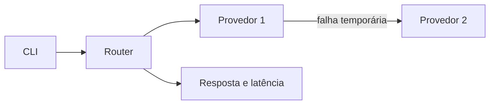

# Roteador de LLM
> Mantém respostas disponíveis ao tentar outro provedor quando o primeiro falha temporariamente.

**O que este projeto prova**
- Consulta provedores em sequência até obter uma resposta válida.
- Informa qual provedor respondeu e quanto tempo levou.
- Diferencia falhas temporárias de erros de configuração.

## Demonstração


O roteador tenta três provedores até obter uma resposta válida.

## Como funciona

- A solicitação segue para os provedores configurados para a tarefa.
- Falhas temporárias ou respostas vazias acionam a próxima tentativa.
- A resposta inclui o provedor e sua latência.

## Decisões de projeto
- Timeout, erro 429, erro 5xx e conteúdo vazio acionam fallback.
- Erros HTTP de configuração, como autenticação inválida, são propagados.
- Tarefas desconhecidas e chaves ausentes geram erro de configuração antes de qualquer solicitação.
- Chaves ficam em variáveis de ambiente, fora do arquivo TOML.

<details>
<summary>Detalhes técnicos: stack, como rodar e testes</summary>

Stack: Python 3.12, HTTPX, Pydantic e TOML.

Edite `providers.toml` com URLs e modelos reais e exporte as variáveis indicadas em `.env.example`.
```bash
uv sync
uv run llm-router "Explique automação"
```
Use `--config arquivo.toml` para outra configuração e `--task code` para escolher uma lista configurada em `tasks.code`.

Testes:
```bash
uv run pytest -q
```

Variáveis em `.env.example`: `PROVIDER_ONE_API_KEY` e `PROVIDER_TWO_API_KEY`.
</details>
