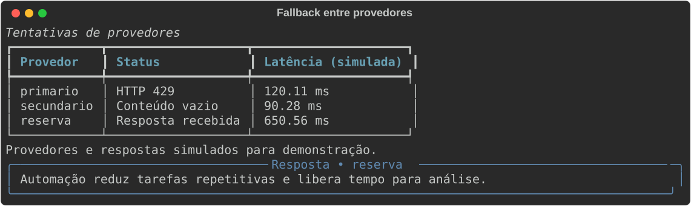
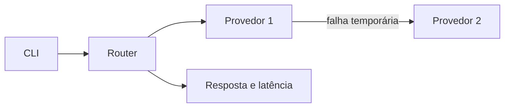

# Roteador de LLM

## Problema
Uma aplicação pode perder disponibilidade quando o provedor de linguagem está indisponível ou retorna conteúdo vazio.

## Solução
Uma cascata consulta provedores compatíveis com a API de chat OpenAI e informa quem respondeu e a latência.

## Demonstração


O roteador tenta três provedores até obter uma resposta válida.

## Arquitetura


## Stack
Python 3.12, HTTPX, Pydantic e TOML.

## Como rodar
Edite `providers.toml` com URLs e modelos reais e exporte as variáveis indicadas em `.env.example`.
```bash
uv sync
uv run llm-router "Explique automação"
```
Use `--config arquivo.toml` para outra configuração e `--task code` para escolher uma lista configurada em `tasks.code`.

## Testes
```bash
uv run pytest -q
```

## Decisões de projeto
- Timeout, erro 429, erro 5xx e conteúdo vazio acionam fallback.
- Erros HTTP de configuração, como autenticação inválida, são propagados.
- Chaves ficam em variáveis de ambiente, fora do arquivo TOML.
