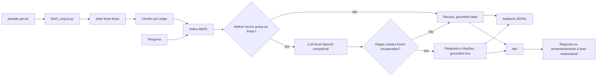

# RAG de normativos
> Responde perguntas em português sobre a LC 108/2001 e a LC 109/2001 citando o artigo de onde a resposta saiu, e recusa quando não encontra.

**O que este projeto prova**
- Recuperação por artigo sobre texto oficial baixado do planalto.gov.br, com metadados de norma e artigo.
- Guardrails verificáveis: recusa sem chamar o LLM quando a busca não acha nada relevante e invalida respostas que citam artigo que não foi recuperado.
- Execução local por padrão (Ollama), com API FastAPI e um fluxo n8n que encaminha para a área responsável o que não tem base.

## Demonstração
Saída real da CLI, com o índice montado e sem modelo rodando na máquina (comportamento de falha do LLM):

```text
$ uv run rag-normativos index
110 artigos indexados em index/chunks.json (bm25)

$ uv run rag-normativos ask "Qual a capital da França?"
Não encontrei isso nos normativos indexados.

grounded: false

$ uv run rag-normativos ask "Qual o mandato dos membros do conselho deliberativo?"
Não consegui gerar a resposta agora (modelo indisponível). A pergunta deve seguir para a área responsável.

grounded: false
```

A segunda pergunta recuperou o Art. 12 da LC 108/2001 em primeiro lugar, mas sem LLM não há resposta a verificar, então nada é afirmado. Com o modelo disponível, a resposta sai com `grounded: true` e as citações (`norma`, `artigo`, `trecho`). Cada chamada grava uma linha no log de auditoria:

```json
{"question": "Qual o mandato dos membros do conselho deliberativo?", "retrieved": ["LC 108/2001 Art. 12", "LC 108/2001 Art. 17", "LC 108/2001 Art. 21"], "grounded": false}
```

## Como funciona

- O texto compilado das duas leis é baixado do Planalto por `scripts/fetch_corpus.py` e versionado limpo em `data/` (texto de lei é domínio público, Lei 9.610/1998, art. 8º, IV).
- Cada artigo, com parágrafos e incisos, vira um chunk com `norma` e `artigo`. Artigos vetados ficam fora.
- A pergunta é buscada por BM25; só passa ao modelo se o melhor trecho atingir o limiar.
- O n8n recebe a pergunta por webhook, chama `POST /ask` e responde com a resposta citada ou avisa que a pergunta foi encaminhada à área responsável.

## Decisões de projeto
- BM25 próprio, sem dependência: é determinístico e testável sem rede. O escore é normalizado pelo máximo que um trecho poderia atingir para aquela pergunta, e termos fora do vocabulário das leis contam contra, o que torna o limiar (0,18, ajustável em `MIN_SCORE`) comparável entre perguntas.
- Limitação conhecida da busca lexical: perguntas que usam palavras diferentes das da lei ("prescrição" contra "prescreve") perdem escore. Embeddings opcionais (`index --embeddings`, endpoint `/embeddings` compatível com OpenAI) cobrem isso; o limiar padrão desse modo (0,55) não foi calibrado.
- Modelo local por padrão (`http://localhost:11434/v1`), para que nada saia da máquina. Apontar `LLM_BASE_URL` para um provedor externo envia trechos de lei pública, nunca dado pessoal.
- Citação conferida depois da geração: todo `Art. N` da resposta precisa estar entre os trechos recuperados. Faixas ("Arts. 12 a 17", com "a", "ao", "até" ou hífen) são expandidas e todos os artigos da faixa precisam ter sido recuperados. Quando a resposta nomeia a norma ("LC 109/2001", "LC nº 109", "Lei Complementar 109", "Lei 109"), o par norma e artigo precisa bater com um trecho recuperado, e só esses trechos aparecem nas citações. Sem norma nomeada, vale só o número.
- Referência explícita a qualquer outra norma (Constituição, CF, Decreto, Resolução, Lei ou LC de outro número) reprova a resposta, porque o corpus só tem a LC 108/2001 e a LC 109/2001. Resposta sem nenhuma citação também é tratada como sem base, porque não é verificável.
- Se o modelo estiver indisponível, a API responde `grounded: false` em vez de erro, para o fluxo n8n encaminhar a pergunta a uma pessoa.
- Auditoria em JSONL com pergunta, artigos recuperados e `grounded`. Interpretação e resposta oficial ficam com a área responsável; esta ferramenta só localiza o texto.
- Avaliação de recuperação em teste: 8 perguntas, com o artigo esperado (extraído do texto em `data/`) entre os 3 primeiros resultados.

<details>
<summary>Detalhes técnicos: stack, como rodar e testes</summary>

Stack: Python 3.12, FastAPI, Uvicorn, HTTPX, Pydantic v2, pytest e uv.

```bash
uv sync
cp .env.example .env
# Exporte as variáveis desejadas; o padrão usa Ollama em localhost:11434.
uv run python scripts/fetch_corpus.py   # opcional: atualiza data/ a partir do Planalto
uv run rag-normativos index             # ou: index --embeddings
uv run rag-normativos ask "Qual o mandato dos membros do conselho deliberativo?"
uv run uvicorn rag_normativos.api:app
```

Exemplo de chamada:
```bash
curl -X POST localhost:8000/ask -H 'content-type: application/json' \
  -d '{"question": "Qual o mandato dos membros do conselho deliberativo?"}'
```
A resposta tem `answer`, `citations` (`norma`, `artigo`, `trecho`) e `grounded`.

O fluxo `n8n/workflow.json` é um export para importar no n8n: Webhook (POST) chama `/ask`, um IF testa `grounded` e dois nós Respond to Webhook devolvem a resposta ou o aviso de encaminhamento. Ajuste a URL do nó HTTP Request ao endereço da API.

Testes:
```bash
uv run pytest -q
```
Os testes usam o corpus local, LLM fictício e transporte HTTP simulado, sem rede. O fetch do corpus não roda nos testes.

Variáveis em `.env.example`: `LLM_BASE_URL`, `LLM_MODEL`, `LLM_API_KEY` (opcional no Ollama), `EMBED_MODEL`, `MIN_SCORE` e `AUDIT_LOG`.
</details>
