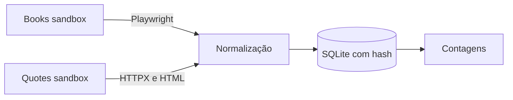

# Coletores RPA
> Automatiza coletas de páginas públicas e identifica mudanças sem duplicar registros.

**O que este projeto prova**
- Coleta e normaliza dados de duas fontes de prática.
- Reconhece registros já coletados em novas execuções.
- Contabiliza criações, alterações e itens inalterados.

## Demonstração


A segunda execução reconhece os registros existentes sem duplicá-los.

## Como funciona

- Cada coletor percorre páginas de uma fonte pública de prática.
- Os dados são normalizados e comparados com os registros salvos.
- A execução informa quantos itens foram criados, alterados ou mantidos.

## Decisões de projeto
- A chave natural e o hash permitem reexecutar sem criar duplicatas e detectar alterações.
- A navegação com Playwright coleta livros em um sandbox público de prática.
- O coletor HTTP evita navegador quando o HTML estático basta.

<details>
<summary>Detalhes técnicos: stack, como rodar e testes</summary>

Stack: Python 3.12, Playwright, HTTPX, BeautifulSoup, Pydantic e SQLite.

Os sites `books.toscrape.com` e `quotes.toscrape.com` são sandboxes públicos para prática de scraping.
```bash
uv sync
uv run playwright install chromium
uv run collect books --pages 2
uv run collect quotes --pages 2 --db records.db
```

Testes:
```bash
uv run pytest -q
```
Os testes usam HTML local e não iniciam navegador nem acessam a rede.
</details>
