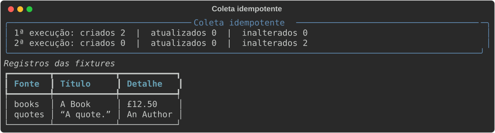
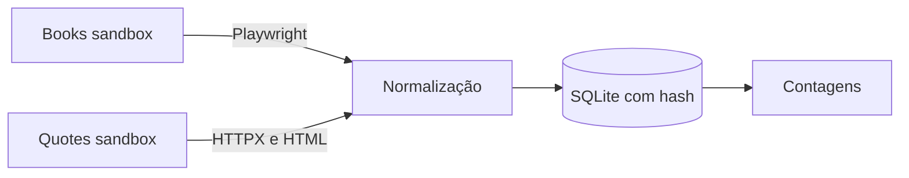

# Coletores RPA

## Problema
Coletas periódicas precisam registrar mudanças sem duplicar dados entre execuções.

## Solução
Dois coletores percorrem páginas públicas de prática e persistem registros normalizados com contagem de criações, atualizações e itens inalterados.

## Demonstração


A segunda execução reconhece os registros existentes sem duplicá-los.

## Arquitetura


## Stack
Python 3.12, Playwright, HTTPX, BeautifulSoup, Pydantic e SQLite.

## Como rodar
Os sites `books.toscrape.com` e `quotes.toscrape.com` são sandboxes públicos para prática de scraping.
```bash
uv sync
uv run playwright install chromium
uv run collect books --pages 2
uv run collect quotes --pages 2 --db records.db
```

## Testes
```bash
uv run pytest -q
```
Os testes usam HTML local e não iniciam navegador nem acessam a rede.

## Decisões de projeto
- A chave natural e o hash permitem reexecutar sem criar duplicatas e detectar alterações.
- A navegação com Playwright representa o padrão de extração de relatórios em sistemas corporativos, como SAP ou Salesforce, respeitando as permissões aplicáveis.
- O coletor HTTP evita navegador quando o HTML estático basta.
