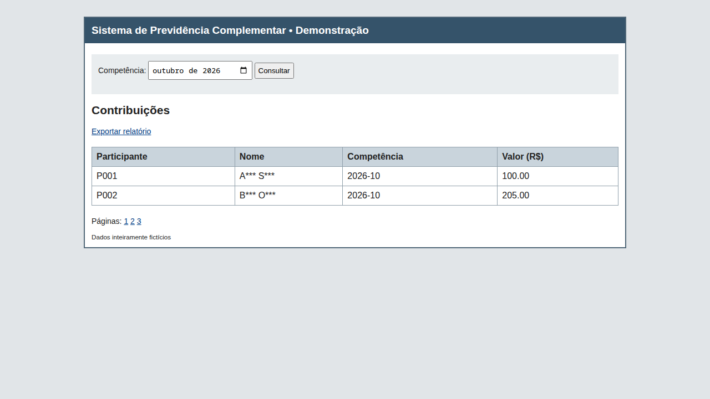
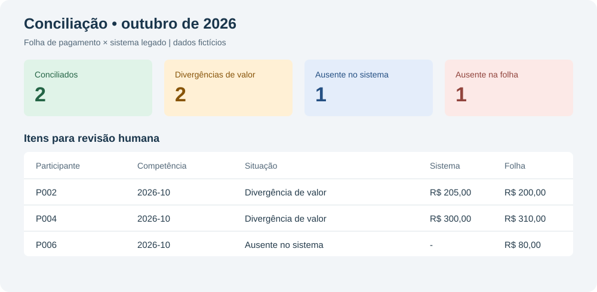
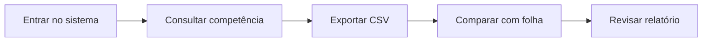

# Conciliação de contribuições no sistema legado
> Compara as contribuições da folha de pagamento com um sistema de previdência complementar sem API e destaca diferenças para revisão.

**O que este projeto prova**
- Automação de navegação e exportação em um sistema sem API.
- Retentativas, evidência de falha e auditoria da execução.
- Conciliação de valores e registros ausentes em planilha.

## Demonstração

Tela paginada de contribuições com nomes mascarados e dados fictícios.

Exemplo de resultados e diferenças que precisam de revisão.

## Como funciona

- O robô acessa a tela e baixa todas as contribuições da competência em CSV.
- A comparação usa participante e competência, com tolerância configurável para valores.
- O relatório XLSX mostra os registros conciliados, ausentes e divergentes; o terminal apresenta um resumo.
- Todas as informações incluídas são fictícias.

## Decisões de projeto
- Uma pessoa revisa as divergências antes de decidir qualquer correção.
- O robô apenas lê e exporta dados: não altera o sistema legado.
- Credenciais vêm do ambiente para evitar incluí-las no código ou na auditoria.

Detalhes técnicos: stack, como rodar e testes

- Python, FastAPI, Playwright síncrono, openpyxl e uv.
- Execute na pasta deste projeto: `cp .env.example .env`, `uv sync` e `uv run playwright install chromium`.
- Rode `uv run rpa-conciliar --competencia 2026-10`. Por padrão, inicia o sistema fictício local e usa `data/folha.xlsx`.
- Use `--url` para um sistema compatível já iniciado, `--folha` para outra planilha e `--saida` para outra pasta. A folha deve ter as colunas `participant_id`, `competencia` e `valor`.
- A saída contém `sistema.csv`, `conciliacao.xlsx` e `audit.jsonl`; em falha de navegação, inclui `falha.png`. A captura pode conter dados da tela e deve ser protegida.
- Configure `LEGACY_USER`, `LEGACY_PASSWORD`, `LEGACY_SECRET`, `LEGACY_DELAY_SECONDS` e `RPA_TOLERANCE` no `.env`. A demora simulada é em segundos e a tolerância é em reais.
- Testes: `uv run pytest -q`. Os testes de navegador são marcados `e2e` e são ignorados quando o Chromium não está instalado.

