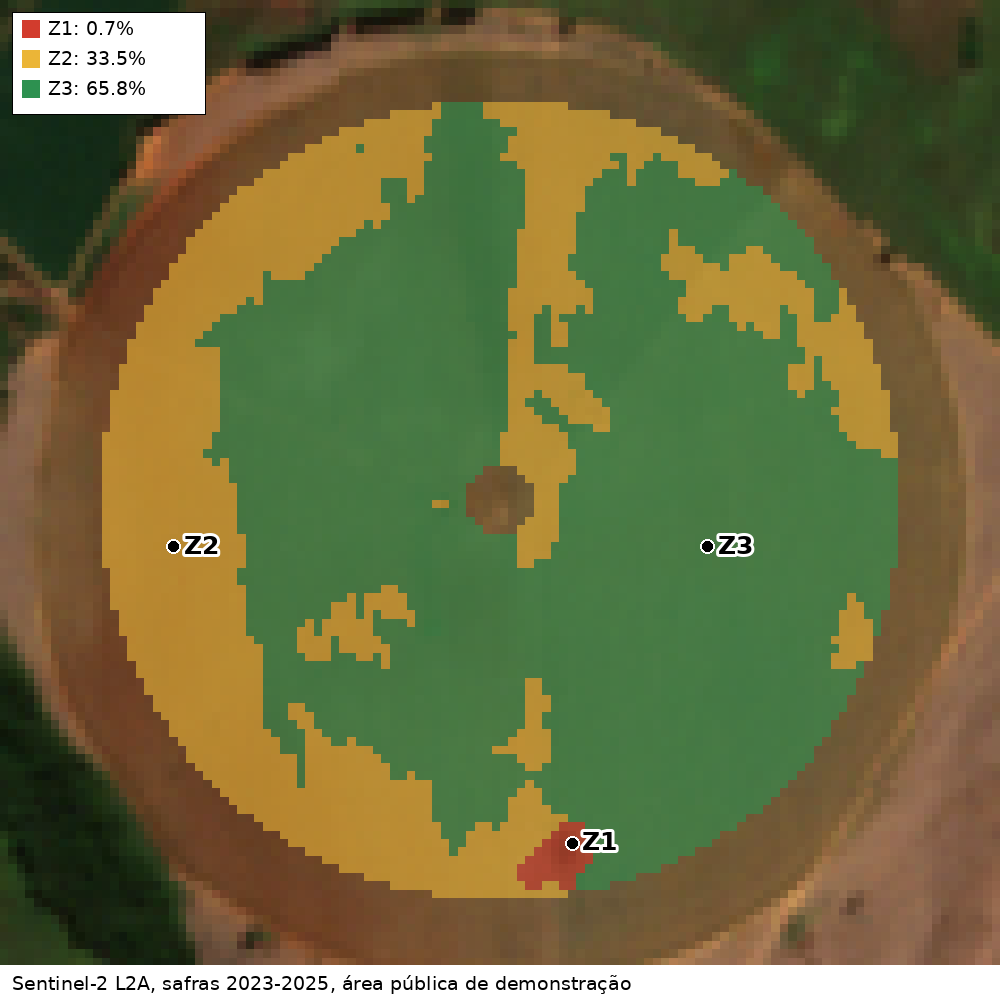
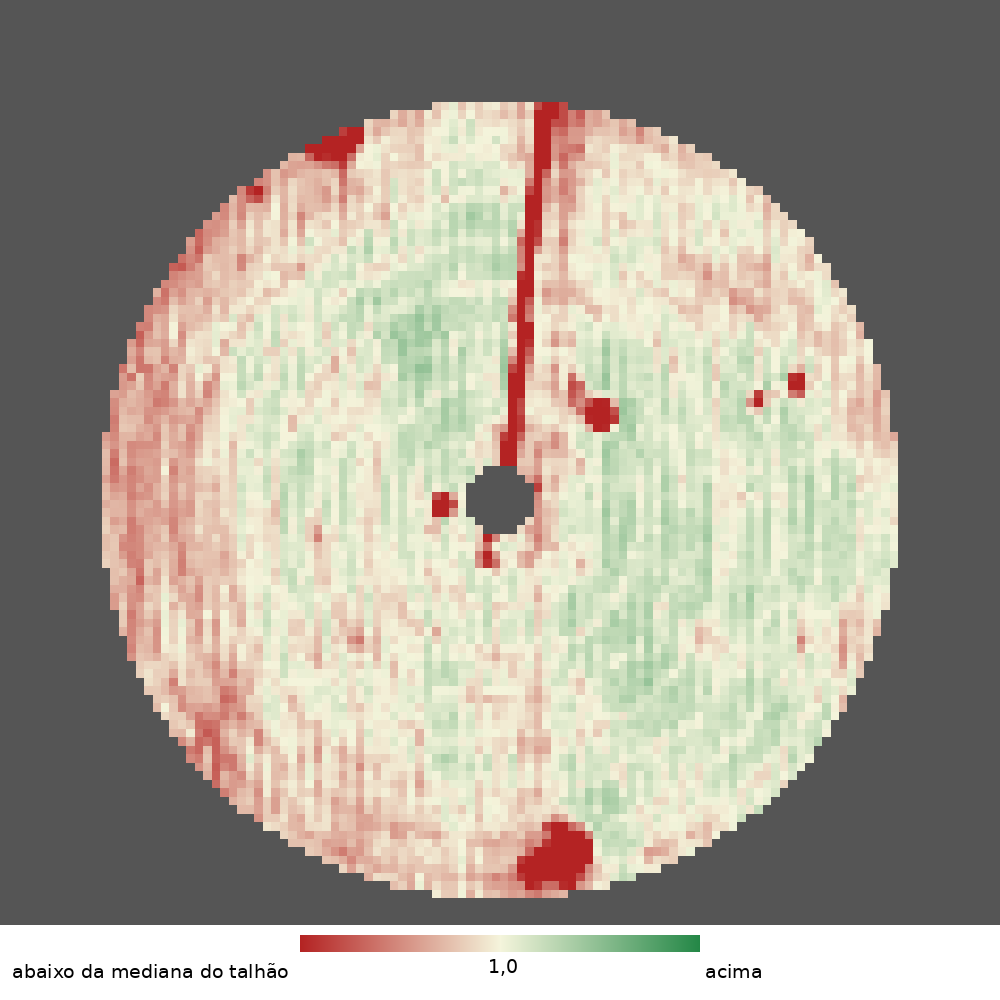
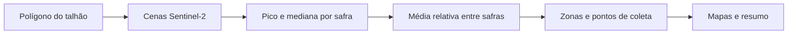

# Zonas de manejo para amostragem de solo
> Identifica diferenças persistentes de vegetação em um talhão e sugere onde coletar amostras de solo.

**O que este projeto prova**
- Compara o talhão consigo mesmo em diferentes safras.
- Separa áreas de menor e maior vigor relativo e sugere pontos de coleta.
- Gera mapas, pontos geográficos e um resumo auditável das cenas utilizadas.

## Demonstração

Zonas ordenadas do menor para o maior NDVI relativo; Z1, Z2 e Z3 marcam os pontos sugeridos e a legenda mostra a porcentagem da área mapeada.

Vermelho indica valores abaixo da mediana do talhão; verde indica valores acima.

## Como funciona

- Para cada safra, usa o maior NDVI válido de cada pixel e divide pela mediana do talhão.
- Calcula a média entre safras e agrupa os valores em zonas ordenadas.
- Exclui um disco de 40 m no centro do pivô e uma faixa de 20 m na borda interna. Uma mediana local reduz linhas finas e manchas menores que 2.500 m² são incorporadas às zonas vizinhas. O ponto de coleta fica no pixel mais distante da borda do maior componente de cada zona.
- As zonas indicam onde amostrar o solo; não diagnosticam a causa das diferenças. A análise laboratorial investiga essa causa.

## Decisões de projeto
- Imagens públicas Sentinel-2 L2A do Microsoft Planetary Computer dispensam chave, mas dependem da disponibilidade do serviço.
- A área circular aproximada em Cristalina, GO, foi escolhida apenas para demonstração; não representa um limite cadastral ou recomendação agronômica.
- A comparação pela mediana do próprio talhão destaca diferenças internas, sem comparar diretamente culturas ou propriedades.

Detalhes técnicos: stack, como rodar e testes

- Python 3.12, uv, NumPy, SciPy, scikit-learn, Rasterio, Pillow, PySTAC Client e planetary-computer.
- Cada safra corresponde a janeiro a junho de um ano completo; são escolhidas até seis cenas com menos de 20% de nuvens na cena. Pixels classificados como vegetação ou solo exposto são utilizados. Pixels sem observação em pelo menos metade das safras ficam fora do mapa.
- As áreas e porcentagens são aproximadas; as porcentagens usam a área mapeada como denominador. A resolução de análise é próxima de 10 m; as imagens são ampliadas para apresentação.
- Execute `uv run soil-zones --field demo/field.geojson --seasons 3 --k 3 --out out/` para gerar os arquivos. O GeoJSON deve conter um único polígono em longitude e latitude (WGS84). As opções `--center-radius-m`, `--edge-buffer-m` e `--min-patch-area-m2` ajustam as exclusões e a área mínima; o centro do pivô é estimado pelo centro da extensão do polígono.
- Execute `uv run pytest -q` para rodar os testes offline. A execução real requer acesso à internet e não exige variáveis de ambiente.

