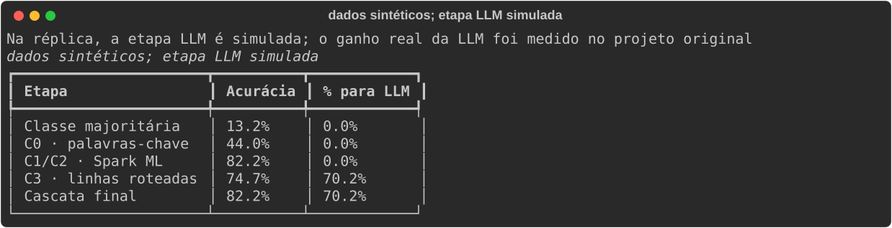
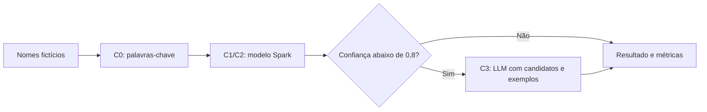

# Classificação de empresas com Spark e IA

> Uma cascata de classificação para empresas, com consulta seletiva à LLM nos casos de menor confiança.

**O que este projeto demonstra**

- O projeto original processou uma base de 28,4 milhões de empresas, dos dados abertos CNPJ da Receita, em Spark num desktop.
- No teste original, o baseline Dummy atingiu 23,8% e o C2 (Spark ML), 71,7%.
- No recorte comparado com LLM, de 2.996 casos, a LLM zero-shot atingiu 54,9%, o C2 59,8% e a LLM com contexto (top-3 do C2 + exemplos) 63,9%.
- O roteamento para a LLM ocorre somente abaixo de 0,8 de confiança.

Split 80/10/10 por hash do CNPJ básico, limiar calibrado em split separado.

## Demonstração

Na réplica, a etapa LLM é simulada; o ganho real da LLM foi medido no projeto original. O simulador retorna o primeiro candidato, portanto não produz ganho de acurácia sobre o C2. O Spark nesta réplica roda localmente sobre dados sintéticos para mostrar o pipeline, não a escala do projeto original.

## Como funciona

O Spark calcula confiança, roteamento e métricas. Somente as linhas roteadas são coletadas para consulta ao provedor. A acurácia de C3 considera apenas essas linhas; a acurácia da cascata final considera todo o teste.

Detalhes técnicos: stack, como rodar e testes

- Python, PySpark ML, Rich e pytest. Java 17 deve estar disponível no PATH ou em `JAVA_HOME`.
- Execute `uv run spark-cascade --rows 2000 --threshold 0.8` e `uv run pytest -q`.
- Para gerar a imagem: `uv run spark-cascade --rows 2000 --threshold 0.8 --svg docs/cascata.svg`.
- O provedor padrão é simulado. Opcionalmente, configure `OPENAI_BASE_URL`, `OPENAI_MODEL` e `OPENAI_API_KEY` conforme `.env.example` e use `--provider openai`.
- A réplica usa validação cruzada em duas partições do treino e avaliação em teste separado, com TF-IDF e regressão logística multinomial.

