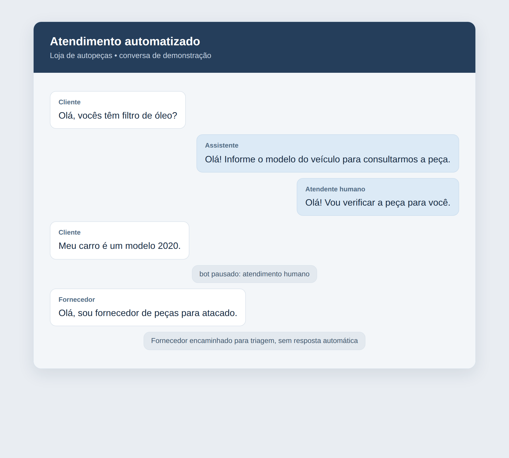
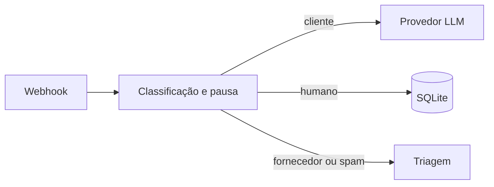

# Assistente para loja de autopeças
> Automatiza a triagem de mensagens e libera o atendimento para intervenção humana.

**O que este projeto prova**
- Responde a clientes com apoio de um modelo de linguagem.
- Pausa o bot quando uma pessoa assume a conversa.
- Identifica fornecedores e spam, protege dados pessoais e registra decisões para auditoria.

## Demonstração


A conversa demonstra a pausa após intervenção humana e a triagem de fornecedor.

## Como funciona

- O webhook verifica se a conversa está pausada.
- Mensagens de clientes seguem para o modelo; fornecedores e spam são sinalizados.
- A resposta é retornada pelo webhook, sem envio real ao WhatsApp.

## Decisões de projeto
- Atendimento humano pausa a conversa por 12 horas por padrão, configurável por `HUMAN_PAUSE_HOURS`.
- Fornecedores são sinalizados e spam é silenciado, sem resposta automática.
- Dados pessoais são mascarados antes do envio ao modelo; o log de auditoria registra decisões sem conteúdo ou telefone em claro.
- O simulador usa um provedor fictício e não precisa de credenciais.

<details>
<summary>Detalhes técnicos: stack, como rodar e testes</summary>

Stack: Python 3.12, FastAPI, Pydantic, HTTPX e SQLite.

```bash
uv sync
uv run python simulate.py
```
Para usar a API real, configure as variáveis de `.env.example` no ambiente e execute `uv run uvicorn app:app`. A URL base deve apontar para uma API compatível com OpenAI, incluindo `/v1` quando necessário.

Testes:
```bash
uv run pytest -q
```

Variáveis em `.env.example`: `LLM_BASE_URL`, `LLM_API_KEY`, `LLM_MODEL`, `DATABASE_PATH`, `HUMAN_PAUSE_HOURS` e `AUDIT_LOG_PATH` (padrão: `audit.jsonl`).
</details>
