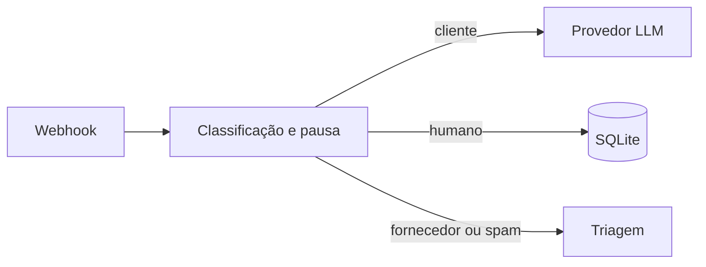

# Assistente para loja de autopeças

## Problema
Atendimentos repetitivos precisam de triagem sem interromper o trabalho humano.

## Solução
Um webhook classifica mensagens, consulta um provedor de LLM para clientes e pausa o bot após atendimento humano. A resposta é retornada pelo webhook, sem envio real ao WhatsApp.

## Demonstração


A conversa demonstra a pausa após intervenção humana e a triagem de fornecedor.

## Arquitetura


## Stack
Python 3.12, FastAPI, Pydantic, HTTPX e SQLite.

## Como rodar
```bash
uv sync
uv run python simulate.py
```
Para usar a API real, configure as variáveis de `.env.example` no ambiente e execute `uv run uvicorn app:app`. A URL base deve apontar para uma API compatível com OpenAI, incluindo `/v1` quando necessário.

## Testes
```bash
uv run pytest -q
```

## Decisões de projeto
- Atendimento humano pausa a conversa por 12 horas por padrão, configurável por `HUMAN_PAUSE_HOURS`.
- Fornecedores são sinalizados e spam é silenciado, sem resposta automática.
- O simulador usa um provedor fictício e não precisa de credenciais.
